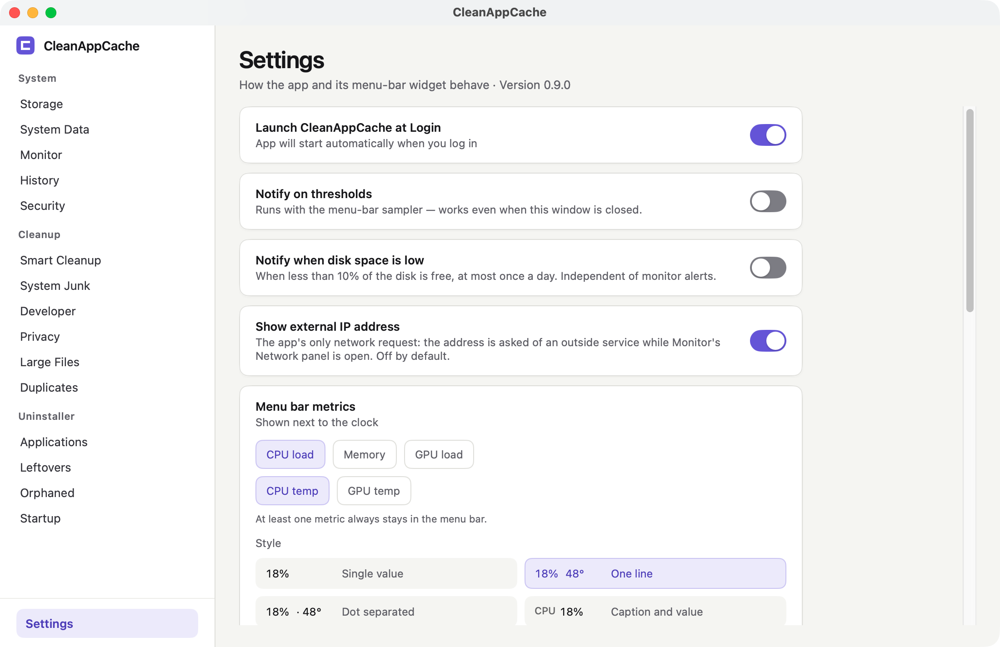

# CleanAppCache

CleanAppCache is a native macOS app. It shows how much disk space each category uses, removes caches and other files you select, uninstalls apps and their associated files, and monitors system activity. It checks every deletion against a list of protected paths first.

[Русская версия](README.ru.md)

[](https://github.com/evgeniyov/CleanAppCache/actions/workflows/ci.yml) [](LICENSE) 


<table>
<tr><td width="50%"><br><sub>Smart Cleanup preselects safe items. You can select the rest.</sub></td><td width="50%"><br><sub>The rules shown on first launch</sub></td></tr>
<tr><td width="50%"><br><sub>What Finder calls "System Data"</sub></td><td width="50%"><br><sub>Monitor with sensors in the dark theme</sub></td></tr>
<tr><td width="50%"><br><sub>Settings and the menu bar widget</sub></td></tr>
</table>

## Status

- **Download.** Get the DMG from the [Releases](https://github.com/evgeniyov/CleanAppCache/releases/latest) page. Version 0.9 is a public beta.
- CleanAppCache is **not notarized yet** because the Apple Developer account is pending. macOS blocks the first launch. Move the app to Applications and open it once. On macOS 15 and later, open Privacy & Security in System Settings and click **Open Anyway**. On macOS 13 and 14, Control-click the app, choose **Open**, and confirm. You can also build from source.
- **Tested.** Testing covered an Apple Silicon Mac (M4) running macOS 27 and CI on macOS 15.
- **Untested.** The app is a universal binary and targets macOS 13. The Intel slice has never run on Intel hardware, and the app has never run on macOS 13 or 14. Open an issue to report results from other hardware and macOS versions.

## Features

The sidebar has three sections, plus Settings and a menu bar widget. You can switch between English and Russian without restarting.

### System

- **Storage** shows volume capacity and splits the used space into categories: apps, the macOS and service volumes, system data, `~/Library` by section, your own folders in the home folder and hidden folders. Each group lists its members with sizes. Space the app cannot read is shown with the reason, such as folders that need Full Disk Access. You can browse folder metadata, including hidden folders, and cancel a measurement. "What changed" compares daily snapshots and lists what grew or shrank since the previous measurement, over 7 days or over 30 days. A change measured from incomplete data is marked as uncertain.
- **System Data** lists what Finder groups under "System Data": purgeable space, local Time Machine snapshots, swap and sleep image, system caches and logs, the Spotlight index and staged updates. You can delete local snapshots.
- **Monitor** shows total and per-core CPU usage, memory and memory pressure, GPU, network, disk I/O and NVMe SSD health, temperatures, CPU cluster frequencies and battery status. You can search the process list and quit a process. Use Settings to set threshold alerts for CPU load, CPU temperature and critical memory pressure.
- **History** lists up to 300 recent cleanups with the date, section, estimated space freed and size moved to the Trash. The total covers the records still in History. The chart shows up to 12 recent cleanups.
- **Security** runs eight checks: FileVault, firewall, Gatekeeper, SIP, automatic login, guest account, software updates and screen lock.

### Cleanup

The cleanup screens list skipped paths separately and give the reason: a running app, recent writes, protection, or a read or measurement failure. The app leaves those paths unselected and excludes them from the cleanup total. It uses the installed `uv cache clean` command and its lock to clean the uv cache without interrupting active processes. The app cannot delete uv cache folders directly.


- **Smart Cleanup** lists user caches, system caches, browser caches, logs, temporary files, old installers in Downloads and the Trash. It preselects only user caches, logs and temporary files.
- **System Junk** finds Xcode DerivedData, Archives and device logs, iPhone backups, Quick Look cache, Mail downloads and incomplete downloads in Downloads and Desktop.
- **Developer** finds tool caches for Xcode, Simulator, SwiftPM, CocoaPods, Carthage, npm, Yarn, pip, uv, Gradle, Maven, Homebrew, Go and Cargo, among others. It also finds Docker and OrbStack disk images and project build artifacts (`node_modules`, Rust `target`, SwiftPM `.build`). Developer preselects caches that tools regenerate. Both the default selection and Select All skip items whose deletion would lose data, such as Xcode Archives, simulator devices or a Docker disk image. The project search skips hidden folders at the top of your home folder, such as `~/.vscode` and `~/.nvm`, as well as `~/Library` and `~/Applications`. In those folders, `node_modules` belongs to installed tools.
- **Privacy** clears history, cookies and site data across every profile in Safari, Chrome, Firefox, Brave and Arc. The confirmation tells you that clearing cookies signs you out of sites. Privacy keeps bookmarks, passwords, autofill and extensions' own storage. It clears Firefox history inside `places.sqlite` and keeps the file because it also holds bookmarks.
- **Large Files** finds the largest files in the home folder or on the whole disk. You can filter by size and age and preview files with Quick Look.
- **Duplicates** groups files by size, checks a partial hash, then compares a full SHA-256 hash. You can scan Home, Downloads, Documents or Desktop.

### Uninstaller

- **Applications** lists installed apps, their sizes, versions and last-opened dates. It finds related files in `~/Library` (Caches, Preferences, Containers, Application Scripts, Application Support, Logs, Saved Application State, HTTPStorages, WebKit, Cookies). It looks for an exact bundle ID match or the `<bundleID>.` prefix and skips matches that belong to a more specific installed bundle ID. For apps without a bundle ID, it looks for an exact folder-name match. It keeps Group Containers and app-group Application Scripts because their names do not establish exclusive ownership. Two installed copies with the same bundle ID keep their shared data. The app skips any bundle that has changed until you rescan. The confirmation names the running apps that will quit first. It tells you when macOS will ask for an administrator password for a protected app installed by a package or the App Store.
- **Leftovers** finds files in `~/Library` that belong to removed apps (Preferences, Caches, Application Support, Containers, Saved Application State, HTTPStorages, WebKit). It leaves out data belonging to installed apps, including extensions and helpers inside those apps and folders named after them. If a bundle ID belongs to a vendor that still has an installed app, Leftovers marks it for review and excludes it from Select All.
- **Orphaned items** lists launch agents, daemons and privileged helpers whose program or owning app is gone. It excludes Apple items. Finder asks for your password and moves items under `/Library` to the Trash.
- **Startup items** lists login items, user and global launch agents, and daemons. You can turn off agents for your account without a password. Turning off daemons requires one administrator password.

### Menu bar and Settings

- **Menu bar widget** shows CPU, memory and GPU load and CPU and GPU temperatures next to the clock. Settings shows a live preview. The widget has eight layouts: single value, one line, dot separated, caption and value, two lines, sparkline, gauge and per-core bars.
- **Settings** lets you configure open at login, Monitor alerts, external IP lookup, the menu bar widget, table density, the light or dark theme and language. You can also reset size caches, clear history and open logs.

## How deletion works

**The app moves items to the Trash and shows an Undo toast** for Smart Cleanup categories, Large Files, Duplicates, Leftovers, Orphaned items and System Junk. Finder asks for your password and moves files your account cannot move, such as root-owned caches in `/Library/Caches` and `/var/log`. Use Put Back in the Trash to restore those files.

The app turns off **Startup items** and leaves their files in place.

When the app cannot remove an item, it gives a reason and offers an action. It reports when it needs an administrator password, when macOS privacy controls (Full Disk Access or App Management) or System Integrity Protection block removal, or when a file is locked or in use.

**The app always asks you to confirm permanent deletion** for:

- Emptying the Trash (Smart Cleanup's Trash category).
- Uninstalling an app bundle and its associated files.
- Developer caches and build artifacts. Most regenerate on the next build or install. The app never preselects items that do not regenerate (Xcode Archives, simulator devices, the Docker and OrbStack disk images, Go modules, the Pub cache). The confirmation explains what deleting each item removes.
- Privacy browser data. Restoring this data from the Trash would undo the requested deletion.
- Local Time Machine snapshots (via `tmutil`). This requires Full Disk Access. Time Machine may refuse.

The app deletes protected apps and system-owned items in the Trash as root after one administrator password for the batch. Root deletion applies only to app bundles in application folders, items in your Trash and an app's own entries in `~/Library`.

The app checks every deletion with **PathGuard** (`Core/PathGuard.swift`). Large Files and Duplicates can scan the whole disk, so PathGuard uses a deny-list in place of an allow-list. It refuses:

- the filesystem root and top-level directories;
- SIP-protected system paths, sensitive `/Library` subtrees, and package-manager trees (`/usr`, `/opt/homebrew`, `/opt/local`);
- the home folder and its standard folders, other users' homes and `/Users/Shared`;
- sensitive user data: keychains, Mail, Messages, SSH, GPG and cloud credentials;
- iCloud Drive and CloudStorage providers, Time Machine and sparsebundle backups, and volume metadata;
- media-library packages (Photos, Final Cut, Logic and similar), virtual machine bundles (`.utm`, `.pvm`, `.vmwarevm`), and anything inside `.git`.

PathGuard resolves symlinks and `..`, then compares paths case-insensitively at path-component boundaries. `Tests/CleanAppCacheTests/DeletionRoutingTests.swift` fails if a destructive filesystem call appears outside a short list of exempt files. This flags new calls that bypass PathGuard.

Other safeguards:

- **Uninstall** removes each bundle first and its associated files only once the bundle is gone, so an app that cannot be removed keeps its data.
- **Duplicates** names the copy that stays, lets you keep the newest or the oldest, re-checks size and modification date before deleting, and skips a group whose kept copy has changed.
- The app checks temporary files just before deletion to catch **stale results**. It keeps files an app has started using since the scan.
- **iPhone backups** (`MobileSync/Backup`) appear in System Junk and go to the Trash. Emptying the Trash permanently removes them.

Back up your Mac before a large cleanup. Review selections before confirming, especially in the permanent sections.

## Privacy and permissions

- **No analytics or telemetry.** The app stores logs in `~/Library/Logs/CleanAppCache`, replaces the home folder path with `~` and rotates the log at 1 MB.
- **One optional network request.** External IP lookup (`api.ipify.org`) is off by default. It uses an ephemeral session and runs only while Monitor's network panel is open.
- **Unsandboxed.** The sandbox would block access to `~/Library` and other apps' caches. Signed builds use the hardened runtime and have only the Apple Events automation entitlement.
- **Full Disk Access** is optional. Without it, the app cannot measure some areas or remove some items. For example, it cannot measure the Spotlight index or delete snapshots. A banner lists what the app cannot access.
- **Apple Events** let the app list login items through System Events and ask Finder to move protected files to the Trash. macOS shows its own password dialog for administrator actions.
- macOS asks for Desktop, Documents and Downloads access when a scan reaches those folders.
- **Not on the Mac App Store.** The store requires the sandbox. Monitor reads sensors through private APIs (IOReport, SMC, IOHID).

## Build from source

Requirements:

- The app runs on macOS 13 or later.
- Build with Xcode 16 (Swift 6 toolchain), as in CI. `Package.swift` declares swift-tools-version 5.9, so the code compiles in Swift 5 language mode. The library target enables strict concurrency checking.
- Use `python3` to run `build.py`. It needs no third-party packages.

```bash
python3 build.py          # universal release build, CleanAppCache.app and CleanAppCache.dmg
open CleanAppCache.app

swift build               # debug build
swift test                # XCTest suite
Scripts/verify.sh         # what CI runs: invariants, warnings-as-errors build, tests, build.py, bundle checks
```

`build.py` signs with a local "CleanAppCache Local" identity if one exists, or signs ad hoc. Run `Scripts/make_signing_identity.sh` once to create that identity. macOS ties Full Disk Access and other permissions to the signature. An ad hoc signature changes on every rebuild, so you would have to grant permissions again each time.

Notarized build (requires an Apple Developer ID and a `notarytool` keychain profile):

```bash
DEVELOPER_ID="Developer ID Application: …" NOTARY_PROFILE="profile-name" python3 build.py
```

The command signs with Developer ID, notarizes the build and staples the notarization ticket. `.github/workflows/release.yml` does the same on a `v*` tag once you configure the Developer ID secrets.

## Project layout

```
CleanAppCache/
├── Package.swift
├── build.py                     # universal .app + DMG, optional notarization
├── entitlements.plist           # not sandboxed; Apple Events only
├── Sources/
│   ├── CleanAppCache/           # thin executable: @main, app delegate, menu bar
│   └── CleanAppCacheLib/        # all logic and UI
│       ├── Core/                # managers and services, including:
│       │   ├── PathGuard.swift      # deny-list checked before every delete
│       │   ├── TrashService.swift   # move to Trash with Undo
│       │   ├── DeletionService.swift# permanent deletion
│       │   └── AppManager.swift     # app discovery and uninstall
│       ├── Models/  ViewModels/  Views/  Components/  Design/
│       └── Resources/           # en and ru localizations
├── Tests/CleanAppCacheTests/
├── Scripts/                     # verify.sh, check_invariants.sh, signing and bundle checks
└── .github/workflows/           # ci.yml, release.yml
```

See [CONTRIBUTING.md](CONTRIBUTING.md) for build instructions and contribution rules.

## Known limitations

- Monitor reads temperatures through SMC and IOHID, and frequencies and GPU load through IOReport. It displays "—" for values the Mac does not expose.
- Testing covers one Apple Silicon Mac and CI virtual machines, which have no sensors. Intel Macs and macOS 13 and 14 are untested.
- The project has a single maintainer.

## Contributing

See [CONTRIBUTING.md](CONTRIBUTING.md).

## Security

To report a vulnerability, see [SECURITY.md](SECURITY.md).

## License

CleanAppCache uses the MIT license. See [LICENSE](LICENSE). The software is provided as is, without warranty. It deletes files. Keep backups.
