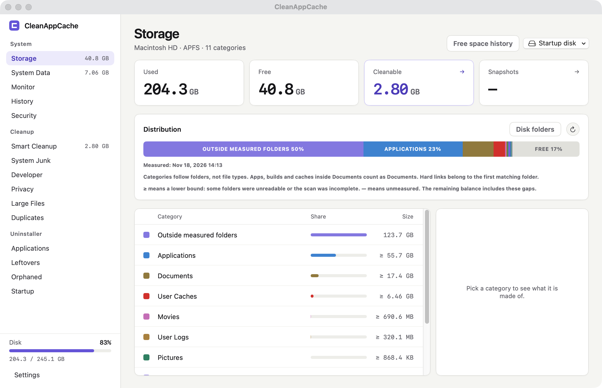
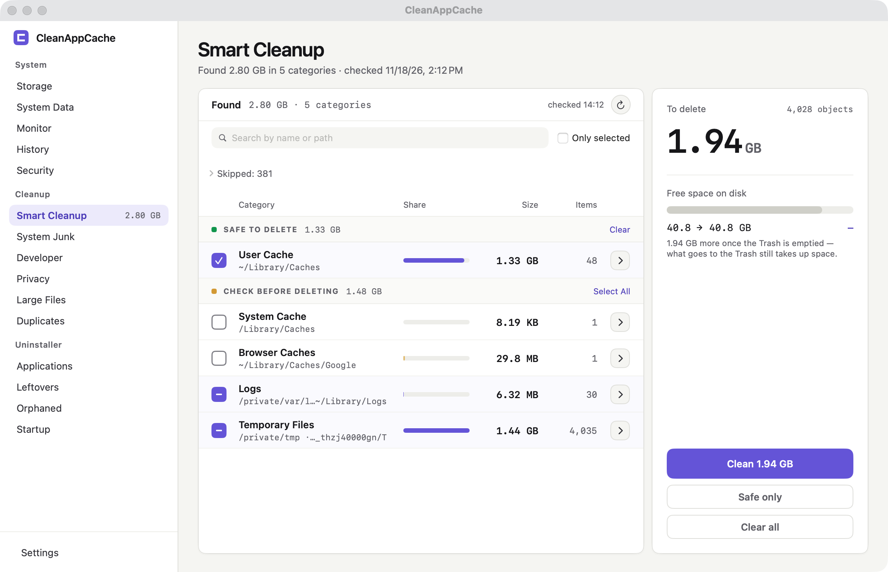
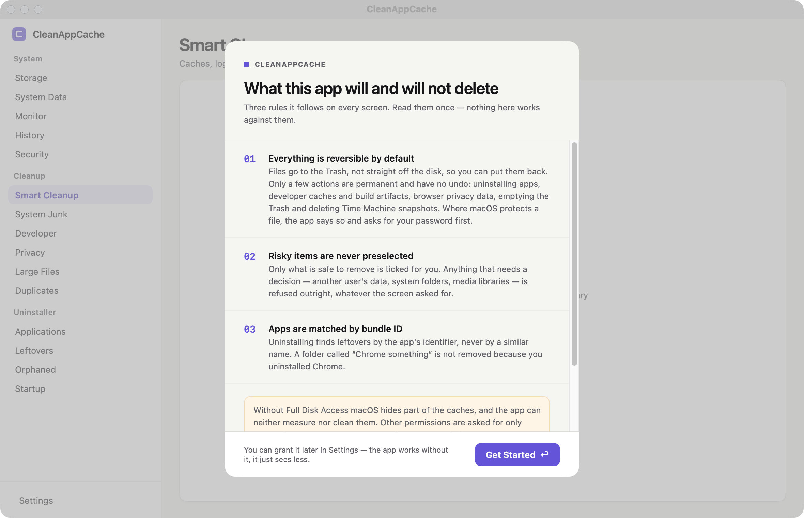
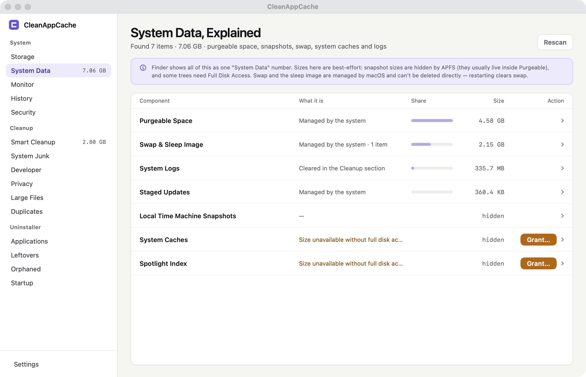
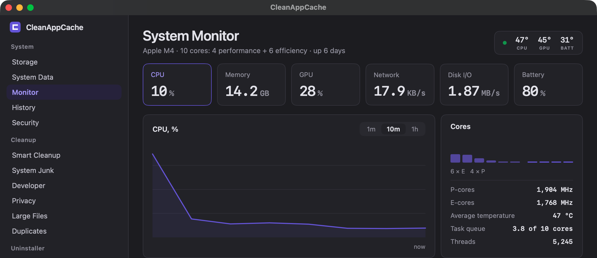

# CleanAppCache

A native macOS app that shows where your disk space goes, cleans caches and junk, uninstalls apps together with their leftovers, and monitors the system. Every delete is checked against a list of protected paths first.

[Русская версия](README.ru.md)

[](https://github.com/evgeniyov/CleanAppCache/actions/workflows/ci.yml) [](LICENSE) 



<table>
<tr><td width="50%"><br><sub>Smart Cleanup: safe items are preselected, the rest wait for you</sub></td><td width="50%"><br><sub>The rules shown on first launch</sub></td></tr>
<tr><td width="50%"><br><sub>What Finder's “System Data” is made of</sub></td><td width="50%"><br><sub>Monitor with sensors, in the dark theme</sub></td></tr>
<tr><td width="50%"><br><sub>Settings and the menu bar widget</sub></td></tr>
</table>

## Status

- **Download:** the DMG is on the [Releases](https://github.com/evgeniyov/CleanAppCache/releases/latest) page. Version 0.9 is a public beta.
- **Not notarized yet** (an Apple Developer account is pending), so macOS blocks the first launch. Move the app to Applications and open it once; then, on macOS 15 and later, open System Settings → Privacy & Security and click **Open Anyway**. On macOS 13 and 14, Control-click the app, choose **Open**, and confirm. You can also build from source (see below).
- **Tested** on an Apple Silicon Mac (M4) running macOS 27, and in CI on macOS 15.
- **Untested:** the app is a universal binary and targets macOS 13, but the Intel slice has never run on Intel hardware and the app has never run on macOS 13 or 14. Issues from other hardware and macOS versions are welcome.

## Features

The sidebar has three sections, plus Settings and a menu bar widget. English and Russian UI, switchable at runtime without a restart.

### System

- **Storage** — volume capacity, measured category folders and an explicitly unexplained balance. Metadata browsing includes hidden folders with bounded, cancellable measurements and per-path restrictions. Complete and partial folder snapshots survive navigation and window reopening during the session; their timestamps identify older results. Private stores stay unscanned, and system/APFS allocations remain separately unmeasured.
- **System Data** — what Finder's "System Data" is made of: purgeable space, local Time Machine snapshots, swap and sleep image, system caches and logs, Spotlight index, staged updates. Local snapshots can be deleted.
- **Monitor** — CPU (total and per core), memory and memory pressure, GPU, network, disk I/O and NVMe SSD health, temperatures, CPU cluster frequencies, battery, and a searchable process list with Quit. Threshold alerts for CPU load, CPU temperature and critical memory pressure are configured in Settings.
- **History** — up to 300 recent cleanup records with the date, section, estimated space freed and size moved to the Trash. The total covers the retained records and the chart shows up to 12 recent cleanups.
- **Security** — eight checks: FileVault, firewall, Gatekeeper, SIP, automatic login, guest account, software updates and screen lock.

### Cleanup

Skipped paths are shown separately with reasons (running app, recent writes, protection, read or measurement failures). They are not selected or counted as cleanable. The uv cache is cleaned only through an installed `uv cache clean`, using its lock without forcing active processes; directly deleting uv cache folders is not supported.


- **Smart Cleanup** — user caches, system caches, browser caches, logs, temporary files, old installers in Downloads, and the Trash. Only user caches, logs and temporary files are preselected.
- **System Junk** — Xcode DerivedData, Archives and device logs, iPhone backups, Quick Look cache, Mail downloads, and incomplete downloads in Downloads and Desktop.
- **Developer** — tool caches (among them Xcode, Simulator, SwiftPM, CocoaPods, Carthage, npm, Yarn, pip, uv, Gradle, Maven, Homebrew, Go, Cargo, and the Docker and OrbStack disk images) and project build artifacts (`node_modules`, Rust `target`, SwiftPM `.build`). Caches that regenerate on their own are preselected; items whose loss matters, such as Xcode Archives, simulator devices or a Docker disk image, are not, and Select All skips them. The search for project artifacts leaves out hidden folders at the top of your home (`~/.vscode`, `~/.nvm`, …), `~/Library` and `~/Applications`, where `node_modules` belongs to installed tools.
- **Privacy** — history, cookies and site data for Safari, Chrome, Firefox, Brave and Arc, across every browser profile. Clearing cookies signs you out of sites; the confirmation says so. Bookmarks, passwords, autofill and extensions' own storage are kept: Firefox history is cleared inside `places.sqlite`, which also holds the bookmarks, instead of deleting the file.
- **Large Files** — the largest files in the home folder or on the whole disk, filtered by size and age, with Quick Look.
- **Duplicates** — files grouped by size, then a partial hash, then a full SHA-256, in Home, Downloads, Documents or Desktop.

### Uninstaller

- **Applications** — installed apps with size, version and last-opened date. Related files in `~/Library` (Caches, Preferences, Containers, Application Scripts, Application Support, Logs, Saved Application State, HTTPStorages, WebKit, Cookies) are matched by bundle ID (exact or `<bundleID>.` prefix, excluding matches owned by a more specific installed bundle ID); an app without a bundle ID falls back to an exact folder-name match. Group Containers and app-group Application Scripts are preserved because their names cannot prove exclusive ownership. Two installed copies with the same bundle ID keep their shared data. Changed app bundles are skipped until rescanned. The confirmation says beforehand when an app is protected (installed by a package or the App Store) and macOS will ask for the administrator password, and which running apps will be quit first.
- **Leftovers** — files in `~/Library` (Preferences, Caches, Application Support, Containers, Saved Application State, HTTPStorages, WebKit) that belong to apps no longer installed. Data of anything installed — including extensions and helpers inside apps, and folders named after an app — is never listed; an id whose vendor still has an app installed is marked for review and left out of Select all.
- **Orphaned items** — launch agents, daemons and privileged helpers whose program or owning app is gone. Apple items are excluded. Items under `/Library` go to the Trash through Finder, which asks for the password.
- **Startup items** — login items, user and global launch agents, and daemons. Agents are turned off per user without a password; daemons after one administrator password.

### Menu bar and Settings

- **Menu bar widget** — CPU, memory and GPU load and CPU/GPU temperature next to the clock, in one of eight layouts (single value, one line, dot separated, caption and value, two lines, sparkline, gauge, per-core bars) with a live preview.
- **Settings** — open at login, Monitor alerts, the external IP lookup, menu bar widget, table density, light or dark theme, language, and maintenance (reset size caches, clear history, open logs).

## How deletion works

**Moved to the Trash, with an Undo toast:** Smart Cleanup categories, Large Files, Duplicates, Leftovers, Orphaned items and System Junk. Files your account cannot move (root-owned caches in `/Library/Caches`, `/var/log`) go to the Trash through Finder, which asks for your password; restore those with Put Back in the Trash.

**Startup items** are turned off, not deleted.

When something cannot be removed, the app says why — an administrator password is needed, macOS privacy protection refused (Full Disk Access or App Management), System Integrity Protection, a locked file, or a file in use — and offers the action that resolves it.

**Permanent, always behind a confirmation that says so:**

- emptying the Trash (Smart Cleanup's Trash category);
- the uninstaller (the app bundle and its associated files);
- Developer caches and build artifacts — most regenerate on the next build or install; the ones that do not (Xcode Archives, simulator devices, the Docker and OrbStack disk images, Go modules, the Pub cache) are never preselected, and the confirmation names what each of them loses;
- Privacy browser data — restoring it from the Trash would bring back exactly what you asked to remove;
- local Time Machine snapshots (via `tmutil`) — this needs Full Disk Access, and Time Machine may refuse.

Protected apps and system-owned items in the Trash are deleted as root after one administrator password for the whole batch; the root delete reaches only app bundles in application folders, items in your Trash, and an app's own entries in `~/Library`.

**PathGuard** (`Core/PathGuard.swift`) is checked before every delete. It is a deny-list, not an allow-list, because Large Files and Duplicates legitimately scan the whole disk. It refuses:

- the filesystem root and top-level directories;
- SIP-protected system paths, sensitive `/Library` subtrees, and package-manager trees (`/usr`, `/opt/homebrew`, `/opt/local`);
- the home folder and its standard folders; other users' homes and `/Users/Shared`;
- sensitive user data: keychains, Mail, Messages, SSH, GPG and cloud credentials;
- iCloud Drive and CloudStorage providers; Time Machine and sparsebundle backups; volume metadata;
- media-library packages (Photos, Final Cut, Logic and similar), virtual machine bundles (`.utm`, `.pvm`, `.vmwarevm`), and anything inside `.git`.

Paths are judged after resolving symlinks and `..`, case-insensitively, on path-component boundaries. `Tests/CleanAppCacheTests/DeletionRoutingTests.swift` fails if a destructive filesystem call appears outside a short list of exempt files, so new code cannot bypass the guard unnoticed.

Other safeguards:

- **Uninstall** removes each bundle first and its associated files only once the bundle is gone, so an app that cannot be removed keeps its data.
- **Duplicates** names the copy that stays, lets you keep the newest or the oldest, re-checks size and modification date before deleting, and skips a group whose kept copy has changed.
- **Stale results** — temporary files are checked again right before they are deleted, so something an app started using since the scan is left alone.
- **iPhone backups** (`MobileSync/Backup`) are offered by System Junk and go to the Trash. Emptying the Trash afterwards makes their removal permanent.

Back up your Mac before a large cleanup. Review selections before confirming, especially in the permanent sections.

## Privacy and permissions

- **No analytics or telemetry.** Logs stay local in `~/Library/Logs/CleanAppCache`; the home folder path is replaced with `~`, and the log rotates at 1 MB.
- **One optional network request:** the external IP lookup (`api.ipify.org`). It is off by default, runs only while Monitor's network panel is open, and uses an ephemeral session.
- **Unsandboxed.** The app has to read `~/Library` and other apps' caches, which the sandbox forbids. Signed builds use the hardened runtime, and the only entitlement granted is Apple Events automation.
- **Full Disk Access** is optional. Without it some areas cannot be measured or cleaned (for example, the Spotlight index size and snapshot deletion); a banner explains what is missing.
- **Apple Events** are used to list login items through System Events and to have Finder move protected files to the Trash; administrator actions use macOS's own password dialog.
- macOS asks for Desktop, Documents and Downloads access when a scan reaches those folders.
- **Not on the Mac App Store**, by design: the App Store requires the sandbox, and the Monitor reads sensors through private APIs (IOReport, SMC, IOHID).

## Build from source

Requirements:

- macOS 13 or later to run.
- Xcode 16 (Swift 6 toolchain) to build, as in CI. `Package.swift` declares swift-tools-version 5.9 so the code compiles in Swift 5 language mode; the library target enables strict concurrency checking.
- `python3` for `build.py` (no third-party packages).

```bash
python3 build.py          # universal release build, CleanAppCache.app and CleanAppCache.dmg
open CleanAppCache.app

swift build               # debug build
swift test                # XCTest suite
Scripts/verify.sh         # what CI runs: invariants, warnings-as-errors build, tests, build.py, bundle checks
```

`build.py` signs with a local "CleanAppCache Local" identity if one exists, otherwise ad-hoc. Run `Scripts/make_signing_identity.sh` once to create that identity: macOS ties Full Disk Access and other permissions to the signature, and an ad-hoc signature changes on every rebuild, so permissions would have to be granted again each time.

Notarized build (requires an Apple Developer ID and a `notarytool` keychain profile):

```bash
DEVELOPER_ID="Developer ID Application: …" NOTARY_PROFILE="profile-name" python3 build.py
```

This signs with Developer ID, notarizes and staples. `.github/workflows/release.yml` does the same on a `v*` tag once the Developer ID secrets are configured.

## Project layout

```
CleanAppCache/
├── Package.swift
├── build.py                     # universal .app + DMG, optional notarization
├── entitlements.plist           # not sandboxed; Apple Events only
├── Sources/
│   ├── CleanAppCache/           # thin executable: @main, app delegate, menu bar
│   └── CleanAppCacheLib/        # all logic and UI
│       ├── Core/                # managers and services, including:
│       │   ├── PathGuard.swift      # deny-list checked before every delete
│       │   ├── TrashService.swift   # move to Trash with Undo
│       │   ├── DeletionService.swift# permanent deletion
│       │   └── AppManager.swift     # app discovery and uninstall
│       ├── Models/  ViewModels/  Views/  Components/  Design/
│       └── Resources/           # en and ru localizations
├── Tests/CleanAppCacheTests/
├── Scripts/                     # verify.sh, check_invariants.sh, signing and bundle checks
└── .github/workflows/           # ci.yml, release.yml
```

See [CONTRIBUTING.md](CONTRIBUTING.md) for the details.

## Known limitations

- Sensors are best-effort. Temperatures come from SMC and IOHID, frequencies and GPU load from IOReport; values a Mac does not expose show "—".
- Hardware coverage is narrow: one Apple Silicon Mac and CI virtual machines, which have no sensors. Intel Macs and macOS 13–14 are untested.
- The project has a single maintainer.

## Contributing

See [CONTRIBUTING.md](CONTRIBUTING.md).

## Security

To report a vulnerability, see [SECURITY.md](SECURITY.md).

## License

MIT — see [LICENSE](LICENSE). The software is provided as is, without warranty. It deletes files; keep backups.
