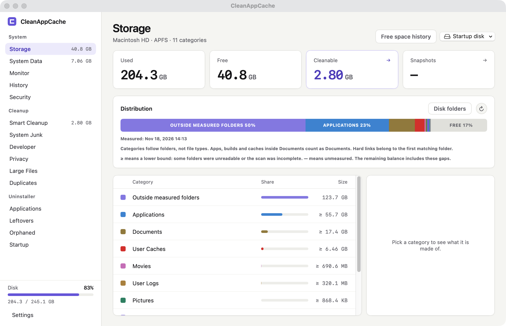
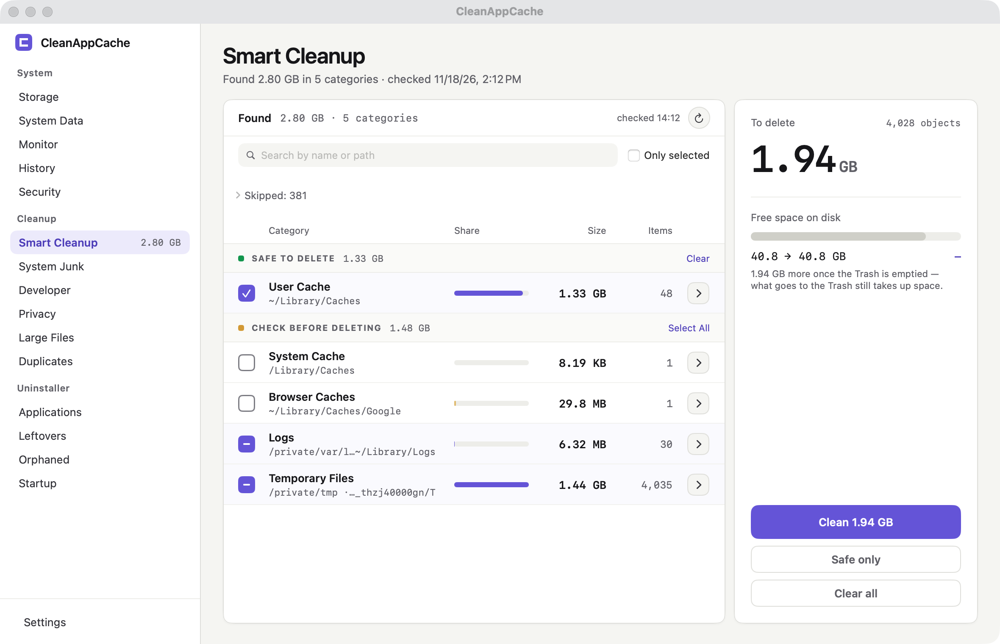
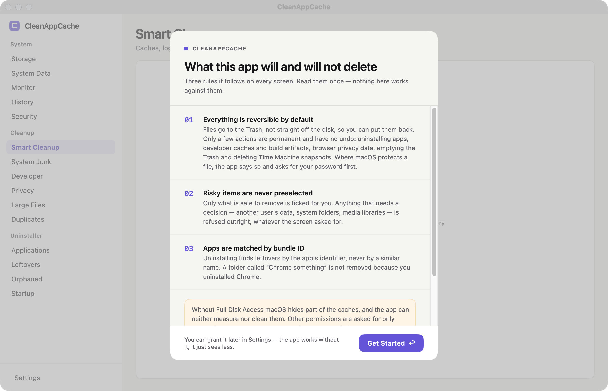
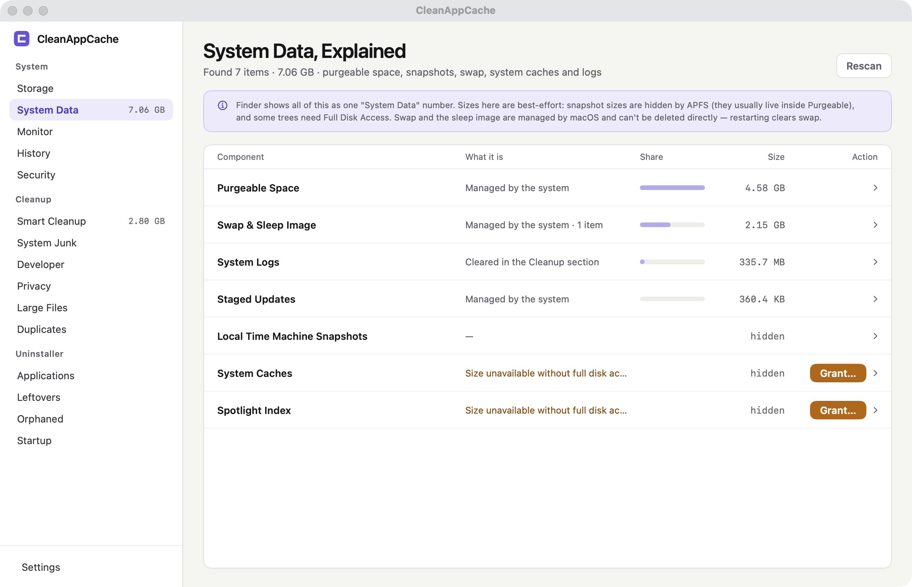
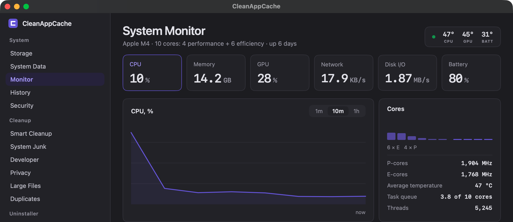
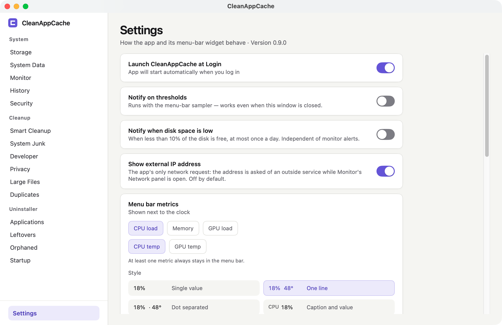

# CleanAppCache

[English version](README.md)

Нативное приложение для macOS: показывает, куда уходит место на диске, чистит кэши и мусор, удаляет приложения вместе с их остатками и следит за состоянием системы. Перед каждым удалением путь сверяется со списком защищённых мест.

[](https://github.com/evgeniyov/CleanAppCache/actions/workflows/ci.yml) [](LICENSE) 



<table>
<tr><td width="50%"><br><sub>«Умная очистка»: безопасное отмечено заранее, остальное — на ваше решение</sub></td><td width="50%"><br><sub>Правила, которые показываются при первом запуске</sub></td></tr>
<tr><td width="50%"><br><sub>Из чего состоят «Системные данные» в Finder</sub></td><td width="50%"><br><sub>«Монитор» с датчиками в тёмной теме</sub></td></tr>
<tr><td width="50%"><br><sub>Настройки и виджет строки меню</sub></td></tr>
</table>

## Состояние проекта

- **Скачать:** DMG лежит на странице [Releases](https://github.com/evgeniyov/CleanAppCache/releases/latest). Версия 0.9 — публичная бета.
- **Сборка пока не нотаризована** (аккаунт Apple Developer ещё оформляется), поэтому macOS блокирует первый запуск. Перенесите приложение в «Программы» и откройте его один раз; затем на macOS 15 и новее откройте «Системные настройки» → «Конфиденциальность и безопасность» и нажмите **«Всё равно открыть»**. На macOS 13 и 14 щёлкните приложение с нажатой Control, выберите **«Открыть»** и подтвердите. Можно также собрать приложение из исходников (см. ниже).
- **Проверено** на Mac с Apple Silicon (M4) под macOS 27 и в CI на macOS 15.
- **Не проверено:** приложение собирается как universal binary и рассчитано на macOS 13, но Intel-часть ни разу не запускалась на Intel-железе, а на macOS 13 и 14 приложение не запускалось вовсе. Сообщения о работе на другом железе и других версиях macOS приветствуются.

## Возможности

В боковой панели три раздела, а также «Настройки» и виджет в строке меню. Интерфейс на английском и русском, язык переключается на ходу без перезапуска.

### Система

- **Хранилище** — ёмкость диска, измеренные папки категорий и явно обозначенный необъяснённый остаток. В обзоре видны скрытые папки; замеры ограничены по времени, отменяемы и показывают ограничения по путям. Полные и частичные результаты сохраняются при навигации и повторном открытии окна в текущем сеансе, с временем замера. Приватные хранилища не сканируются; системные данные и APFS отдельно не измерены.
- **Системные данные** — из чего состоят «Системные данные» в Finder: освобождаемое место, локальные снапшоты Time Machine, подкачка и образ сна, системные кэши и логи, индекс Spotlight, загруженные обновления. Локальные снапшоты можно удалить.
- **Монитор** — процессор (общая загрузка и по ядрам), память и давление памяти, графика, сеть, дисковый ввод-вывод и здоровье NVMe SSD, температуры, частоты кластеров процессора, батарея и список процессов с поиском и кнопкой завершения. Алерты по загрузке CPU, температуре CPU и критическому давлению памяти настраиваются в «Настройках».
- **История** — журнал очисток (до 300 записей) с оценкой освобождённого места по сохранённым записям и графиком последних очисток (до 12). В каждой записи отдельно показано, сколько удалено навсегда и сколько перемещено в Корзину.
- **Безопасность** — восемь проверок: FileVault, сетевой экран, Gatekeeper, SIP, автоматический вход, гостевая учётная запись, обновления ПО и блокировка экрана.

### Очистка

Пропущенные пути показаны отдельно с причинами: работающее приложение, недавние изменения, защита, ошибка чтения или измерения. Они не выбираются для удаления и не входят в доступный объём очистки. Кэш uv очищается только штатной командой установленного uv с проверкой блокировки; активные процессы не прерываются, папка кэша напрямую не удаляется.


- **Умная очистка** — пользовательские кэши, системные кэши, кэши браузеров, логи, временные файлы, старые установщики в «Загрузках» и Корзина. Заранее отмечены только пользовательские кэши, логи и временные файлы.
- **Системный мусор** — DerivedData, архивы и логи устройств Xcode, резервные копии iPhone, кэш Quick Look, загрузки Почты и незавершённые загрузки в «Загрузках» и на «Рабочем столе».
- **Разработка** — кэши инструментов (среди них Xcode, Simulator, SwiftPM, CocoaPods, Carthage, npm, Yarn, pip, uv, Gradle, Maven, Homebrew, Go, Cargo, а также образы дисков Docker и OrbStack) и артефакты сборки проектов (`node_modules`, `target` в Rust, `.build` в SwiftPM). Заранее отмечены кэши, которые сами пересоздаются; то, потеря чего ощутима, — например, архивы Xcode, устройства симулятора или образ диска Docker, — не отмечено, и «Выбрать все» это пропускает. Поиск артефактов сборки обходит скрытые папки в корне домашней папки (`~/.vscode`, `~/.nvm`, …), `~/Library` и `~/Applications`: `node_modules` там принадлежат установленным инструментам.
- **Приватность** — история, cookie и данные сайтов Safari, Chrome, Firefox, Brave и Arc во всех профилях браузера. После удаления cookie придётся заново входить на сайты; окно подтверждения об этом предупреждает. Закладки, пароли, автозаполнение и собственное хранилище расширений остаются: история Firefox очищается внутри `places.sqlite`, где лежат и закладки, а сам файл не удаляется.
- **Большие файлы** — самые крупные файлы в домашней папке или на всём диске, с фильтрами по размеру и возрасту и просмотром через Quick Look.
- **Дубликаты** — файлы группируются по размеру, затем по частичному хэшу, затем по полному SHA-256; поиск в домашней папке, «Загрузках», «Документах» или на «Рабочем столе».

### Деинсталлятор

- **Приложения** — установленные приложения с размером, версией и датой последнего открытия. Связанные файлы в `~/Library` (Caches, Preferences, Containers, Application Scripts, Application Support, Logs, Saved Application State, HTTPStorages, WebKit, Cookies) находятся по bundle ID (точное совпадение или префикс `<bundleID>.`, совпадения с более конкретным bundle ID другого установленного приложения исключаются); для приложения без bundle ID используется точное совпадение имени папки. Group Containers и Application Scripts групп приложений сохраняются: имя не доказывает исключительное владение данными. Две установленные копии с одним bundle ID сохраняют общие данные. Приложения, изменившиеся после сканирования, пропускаются до повторного сканирования. Окно подтверждения заранее говорит, если приложение защищено (установлено пакетом или из App Store) и macOS запросит пароль администратора, а также какие запущенные приложения будут сначала закрыты.
- **Остатки** — файлы в `~/Library` (Preferences, Caches, Application Support, Containers, Saved Application State, HTTPStorages, WebKit), принадлежащие уже удалённым приложениям. Данные всего установленного — включая расширения и помощники внутри приложений и папки, названные по имени приложения, — не показываются никогда; идентификатор, чей производитель ещё установлен, помечается «проверьте» и не отмечается кнопкой «Выбрать всё».
- **Осиротевшие** — launch agents, демоны и привилегированные помощники, чья программа или приложение-владелец уже удалены. Объекты Apple исключены. Объекты из `/Library` уходят в Корзину через Finder, который спрашивает пароль.
- **Автозагрузка** — объекты входа, пользовательские и глобальные launch agents и демоны. Агенты отключаются для вашей учётной записи без пароля, демоны — после одного запроса пароля администратора.

### Строка меню и настройки

- **Виджет в строке меню** — загрузка CPU, памяти и GPU и температура CPU/GPU рядом с часами, в одном из восьми видов (одно значение, в строку, через точку, подпись и значение, в две строки, мини-график, со шкалой, столбики по ядрам) с живым предпросмотром.
- **Настройки** — запуск при входе в систему, алерты монитора, определение внешнего IP, виджет строки меню, плотность таблиц, светлая или тёмная тема, язык и обслуживание (сброс кэша размеров, очистка истории, открытие логов).

## Как устроено удаление

**Перемещается в Корзину, с кнопкой «Отменить» во всплывающем уведомлении:** категории «Умной очистки», «Большие файлы», «Дубликаты», «Остатки», «Осиротевшие» и «Системный мусор». Файлы, которые ваша учётная запись переместить не может (кэши root в `/Library/Caches`, `/var/log`), уходят в Корзину через Finder, который спрашивает пароль; вернуть их можно командой «Вернуть» в Корзине.

**Автозагрузка** отключается, а не удаляется.

Если что-то удалить не удалось, приложение объясняет почему — нужен пароль администратора, отказала защита приватности macOS (полный доступ к диску или «Управление приложениями»), защита целостности системы, файл заблокирован или занят — и предлагает действие, которое это решает.

**Удаляется безвозвратно, всегда после подтверждения, в котором это прямо сказано:**

- очистка Корзины (категория «Корзина» в «Умной очистке»);
- деинсталлятор (бандл приложения и связанные с ним файлы);
- кэши и артефакты сборки в «Разработке» — большинство пересоздаётся при следующей сборке или установке; то, что само не пересоздаётся (архивы Xcode, устройства симулятора, образы дисков Docker и OrbStack, модули Go, кэш Pub), заранее не отмечается, а окно подтверждения называет, что именно пропадёт;
- данные браузеров в «Приватности» — восстановление из Корзины вернуло бы ровно то, что вы просили удалить;
- локальные снапшоты Time Machine (через `tmutil`) — для этого нужен полный доступ к диску, и Time Machine может отказать.

Защищённые приложения и системные объекты в Корзине удаляются от имени root после одного запроса пароля администратора на всю пачку; удаление от root затрагивает только бандлы приложений в папках программ, объекты в вашей Корзине и собственные записи приложения в `~/Library`.

**PathGuard** (`Core/PathGuard.swift`) проверяется перед каждым удалением. Это список запретов (deny-list), а не список разрешений, потому что «Большие файлы» и «Дубликаты» по делу сканируют весь диск. PathGuard не даёт удалить:

- корень файловой системы и каталоги верхнего уровня;
- системные пути под защитой SIP, чувствительные поддеревья `/Library` и деревья менеджеров пакетов (`/usr`, `/opt/homebrew`, `/opt/local`);
- домашнюю папку и её стандартные папки; домашние папки других пользователей и `/Users/Shared`;
- чувствительные пользовательские данные: связки ключей, Почту, Сообщения, учётные данные SSH, GPG и облачных сервисов;
- iCloud Drive и провайдеры CloudStorage; резервные копии Time Machine и sparsebundle; метаданные томов;
- пакеты медиатек (Фото, Final Cut, Logic и подобные), бандлы виртуальных машин (`.utm`, `.pvm`, `.vmwarevm`) и всё, что лежит внутри `.git`.

Пути оцениваются после разрешения символических ссылок и `..`, без учёта регистра и по границам компонентов пути. Тест `Tests/CleanAppCacheTests/DeletionRoutingTests.swift` падает, если разрушающий вызов файловой системы появляется вне короткого списка исключённых файлов, так что новый код не сможет незаметно обойти эту проверку.

Другие меры предосторожности:

- **Удаление приложений** сначала убирает бандл, а связанные файлы — только после того, как бандла не стало, поэтому приложение, которое удалить не удалось, сохраняет свои данные.
- **Дубликаты** показывают, какая копия останется, позволяют оставить самую новую или самую старую, перед удалением заново проверяют размер и дату изменения и пропускают группу, если оставляемая копия изменилась.
- **Устаревшие результаты** — временные файлы проверяются ещё раз прямо перед удалением, так что то, чем приложение начало пользоваться после сканирования, не трогается.
- **Резервные копии iPhone** (`MobileSync/Backup`) предлагаются в «Системном мусоре» и перемещаются в Корзину. Если после этого очистить Корзину, они будут удалены безвозвратно.

Перед крупной очисткой сделайте резервную копию Mac. Просматривайте выбранное перед подтверждением, особенно в разделах с безвозвратным удалением.

## Приватность и разрешения

- **Никакой аналитики и телеметрии.** Логи хранятся локально в `~/Library/Logs/CleanAppCache`; путь к домашней папке в них заменяется на `~`, а лог ротируется при достижении 1 МБ.
- **Один необязательный сетевой запрос:** определение внешнего IP (`api.ipify.org`). По умолчанию он выключен, выполняется только пока открыта панель «Сеть» в «Мониторе» и использует эфемерную сессию.
- **Без песочницы.** Приложению нужно читать `~/Library` и кэши других приложений, а песочница этого не позволяет. Подписанные сборки используют hardened runtime, а единственное выданное разрешение (entitlement) — автоматизация через Apple Events.
- **Полный доступ к диску** не обязателен. Без него часть данных нельзя измерить или очистить (например, размер индекса Spotlight и удаление снапшотов); баннер объясняет, чего не хватает.
- **Apple Events** используются, чтобы получить список объектов входа через System Events и чтобы Finder перемещал защищённые файлы в Корзину; действия от имени администратора идут через собственный диалог пароля macOS.
- macOS запрашивает доступ к «Рабочему столу», «Документам» и «Загрузкам», когда сканирование доходит до этих папок.
- **В Mac App Store приложения нет** — и это сознательно: App Store требует песочницу, а «Монитор» читает датчики через приватные API (IOReport, SMC, IOHID).

## Сборка из исходников

Требования:

- для запуска — macOS 13 или новее;
- для сборки — Xcode 16 (тулчейн Swift 6), как в CI. В `Package.swift` указан swift-tools-version 5.9, поэтому код компилируется в языковом режиме Swift 5; для библиотечного таргета включена строгая проверка конкурентности;
- `python3` для `build.py` (сторонние пакеты не нужны).

```bash
python3 build.py          # universal release build, CleanAppCache.app and CleanAppCache.dmg
open CleanAppCache.app

swift build               # debug build
swift test                # XCTest suite
Scripts/verify.sh         # what CI runs: invariants, warnings-as-errors build, tests, build.py, bundle checks
```

`build.py` подписывает приложение локальной идентичностью «CleanAppCache Local», если она есть, а иначе — ad-hoc-подписью. Один раз запустите `Scripts/make_signing_identity.sh`, чтобы создать эту идентичность: macOS привязывает полный доступ к диску и другие разрешения к подписи, а ad-hoc-подпись меняется при каждой пересборке, и разрешения пришлось бы выдавать заново каждый раз.

Нотаризованная сборка (нужны Apple Developer ID и профиль `notarytool` в связке ключей):

```bash
DEVELOPER_ID="Developer ID Application: …" NOTARY_PROFILE="profile-name" python3 build.py
```

Так приложение подписывается Developer ID, нотаризуется и получает staple-тикет. `.github/workflows/release.yml` делает то же самое по тегу `v*`, как только настроены секреты Developer ID.

## Структура проекта

```
CleanAppCache/
├── Package.swift
├── build.py                     # universal .app + DMG, optional notarization
├── entitlements.plist           # not sandboxed; Apple Events only
├── Sources/
│   ├── CleanAppCache/           # thin executable: @main, app delegate, menu bar
│   └── CleanAppCacheLib/        # all logic and UI
│       ├── Core/                # managers and services, including:
│       │   ├── PathGuard.swift      # deny-list checked before every delete
│       │   ├── TrashService.swift   # move to Trash with Undo
│       │   ├── DeletionService.swift# permanent deletion
│       │   └── AppManager.swift     # app discovery and uninstall
│       ├── Models/  ViewModels/  Views/  Components/  Design/
│       └── Resources/           # en and ru localizations
├── Tests/CleanAppCacheTests/
├── Scripts/                     # verify.sh, check_invariants.sh, signing and bundle checks
└── .github/workflows/           # ci.yml, release.yml
```

Подробности — в [CONTRIBUTING.md](CONTRIBUTING.md).

## Известные ограничения

- Датчики читаются по мере возможности. Температуры берутся из SMC и IOHID, частоты и загрузка GPU — из IOReport; значения, которые конкретный Mac не отдаёт, показываются как «—».
- Покрытие железа узкое: один Mac с Apple Silicon и виртуальные машины CI, в которых датчиков нет. Intel-Mac и macOS 13–14 не проверялись.
- У проекта один мейнтейнер.

## Участие в разработке

См. [CONTRIBUTING.md](CONTRIBUTING.md).

## Безопасность

Как сообщить об уязвимости — см. [SECURITY.md](SECURITY.md).

## Лицензия

MIT — см. [LICENSE](LICENSE). Программа предоставляется «как есть», без каких-либо гарантий. Она удаляет файлы, поэтому храните резервные копии.
